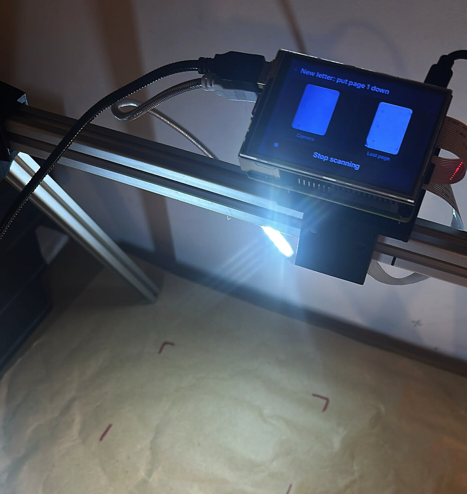

# kuverta

Working title. A **mail client** built around triage: it syncs your IMAP
accounts into a local store, classifies everything, and gives you one
keyboard-first surface to read, reply and file from. Scanned paper mail is
meant to land in the same place.

It started as a read-only triage layer beside a normal client. That did not
replace Apple Mail, because every reply meant leaving the app. Write
capability was added in two stages: **send**, which is additive, then
**mailbox mutation**, which is not. See §1a of
[docs/implementation-plan.md](docs/implementation-plan.md) for what each stage
cost and what replaced the safety the first one had for free.

Status: **usable, not finished.** The window syncs, reads, triages, replies and
sends against real providers. There is no local model yet, and no paper half.

## Two halves

The repository holds two separate things:

- **The Rust half** (`crates/` and `apps/`) is a mail client: IMAP, SMTP, the
  store, accounts, the deterministic classifier.
- **The JavaScript half** ([`kuverta-bird/`](kuverta-bird/)) is the triage surface and
  the classifier, ported to run wherever the mail is. The same code mounts over
  this client and over Thunderbird as an extension, behind a contract each host
  implements.

The second half exists because Thunderbird extensions need Gecko, and Gecko
cannot be embedded outside Mozilla's own applications. To run them you have to
be a Thunderbird. So the surface was written once and given two hosts. See
[docs/thunderbird-fork-brief.md](docs/thunderbird-fork-brief.md) for the
reasoning and [docs/decisions.md](docs/decisions.md) for what it has cost.

`make triage-ui` copies the surface into the desktop app. Then click **triage**
in its header.

## What works today

- **Sync**: IMAP into SQLite + FTS5, incremental via `HIGHESTMODSEQ`, flag
  changes via `CHANGEDSINCE`, server-side deletions reconciled. The first pass
  goes newest first, so recent mail shows while history loads
  ([why](docs/decisions.md#27-the-first-sync-goes-newest-first))
- **Message identity**: a message in several folders is stored once with
  several locations, which Gmail's labels-as-folders needs
- **Send**: compose, reply, reply-all, forward, SMTP submission, and a copy
  filed in Sent via `APPEND`. A reply keeps the answered message on screen
  above it; the seam between them drags, and ↗ moves the reply to its own
  window. The answered message is marked `\Answered` and gets a ↩ in the
  list, whether you answered here or on your phone. Opening a message only
  reads it: a draft shows a *Continue writing* button, and a sent message
  offers Reply as a follow-up to its recipients, without the assistant's
  ✨ Answer
- **Triage**: archive, delete, move, mark read/unread, with a durable queue,
  an undo window, and conflict checks before any write. Works on several
  messages at once, from the keyboard or the right-button menu
- **A desktop window**: three panes, a sidebar of accounts and folders,
  virtualized list (200k rows at 59.8 fps,
  [findings](docs/spike-tauri-list.md)), compose, search, and settings.
  *All inboxes* shows every account in the profile as one list, with smart
  mailboxes merged by name
- **Search and attachments**: search matches word starts in any order and
  treats *eSIM* and *e-SIM* as equal (quotes for a phrase). Attachments are
  listed on each message. Pictures, PDFs and text show in the window and can
  be saved to Downloads or opened in another app. Files that could run
  something are never opened
- **HTML mail, as a page**: a Text and an HTML tab on every message that
  has both. The page is rebuilt from an allow-list in a frame that can run
  nothing and reach nothing. Internet pictures load only when asked for, per
  message. A link opens only after its real address is shown, with anything
  odd about it noted
  ([why](docs/decisions.md#53-html-mail-as-a-page))
- **Invitations**: a `text/calendar` part is shown above the message: what,
  when, where and who else was asked. A wall clock time named by zone is shown
  with its zone and not converted, since a conversion might be wrong. An
  invitation from an address this mailbox has never written to gets no answer
  option, because a reply is what unsolicited invitations fish for.
  Answering and adding the event to a calendar are not built yet
  ([why](docs/decisions.md#56-a-thing-found-in-mail-is-offered-never-applied))
- **Auth**: app passwords in the OS keychain, the OAuth2 device flow
  (RFC 8628) for Microsoft 365, and the loopback flow (RFC 8252, with PKCE)
  for Gmail, which does not accept the device grant
- **A rules classifier**: six categories, German and English, corrections
  override the heuristics
- **Send later**: schedule from compose ("tomorrow 8pm" works), sent by the
  app while it runs. A send interrupted by closing is never retried on a guess
- **Mailboxes and smart mailboxes**: create and delete folders (only empty
  ones, never the account's own). Saved searches have a live preview, import
  from Thunderbird and Apple Mail, and are offered ready-written when you pick
  a run of similar messages
- **Cleanup**: a count of bulk mail in the Inbox, unsubscribing (RFC 8058 one
  click, by mail to the sender's own domain, or a page opened in the browser),
  and an offer to delete a message's look-alikes with it. Deleting a newsletter
  offers to unsubscribe
- **OpenPGP**: sign, encrypt, decrypt and verify PGP/MIME and inline PGP
- **Needs attention**: an urgency agent ranks the Inbox by how soon each
  message needs you. It checks facts first (have you answered, do you write to
  them, deadlines), then the sorting model's judgement, anchored by named
  deadlines
- **Assistant and tasks**: a chat panel with a tool-using model that searches,
  reads and acts on mail (every change undoable, never sends), and hands over
  the message you mean with its attachments. Standing tasks (rules plus an
  action, or a model's instruction) run after each sync, asking first where
  told to and always for replies. Chats are kept and can be reopened. A failed
  answer has a Retry
- **Research online, and skills**: both off until switched on in the
  settings. The assistant then searches the web and reads pages when asked,
  and says where it looked. It opens only addresses you wrote, a search
  returned or a page it read links to, never one from inside a message, and
  reaches nothing on this computer or its network. After reading from the web
  in a question it can look and draft, but not change mail, sign or remember
  anything. A skill is a file of instructions for one kind of job. The
  assistant downloads it from an address you give, and it does nothing until
  you have read the whole text in the settings and accepted it there, which
  no tool can do
  ([why](docs/decisions.md#48-the-assistant-on-the-web-and-the-skills-it-is-handed))
- **PDFs, written and signed**: the assistant writes a letter or a
  confirmation as a PDF. Only when asked, it signs a PDF (its own, or an
  attached contract) with your signature picture from the settings. It puts
  the signature on the document's signature line, and asks which line is yours
  if there is one per party. With no line, you drag the signature onto the
  page and the original is signed again there. The signed copy is a card to
  open, save or attach to a draft. One click on ✨ Answer answers a
  "bitte unterschrieben zurück" with the signed contract attached
- **Tables, as a spreadsheet**: ask "bitte erstelle eine Tabelle mit allen
  meinen Schulden, sortiert nach Höhe und Relevanz", or for a list of what you
  have invested. The assistant searches your mail in German and English, using
  the senders' words as well as yours, and reads the attachments that hold the
  amounts. It writes an **.xlsx** (or a **.csv** if you ask) with rows in the
  order you asked for, figures as figures so the sheet totals them, and a
  column naming each row's source message, so every number can be checked. The
  result is a card to open, save or attach. It says what it searched, and that
  what your mail says is not necessarily what you owe
- **Profiles**: accounts and postal addresses grouped (private, one company,
  another), one profile on screen at a time. It is the first step of the setup
  assistant
- **People**: mail as conversations: one row per person, the exchange in
  bubbles with quotes removed, and a reply box underneath that grows when
  dragged, or moves to its own compose window with ↗
- **Who the message is with**: a card in the right-hand column, above the
  assistant. Click a sender's name to open it, × to close. It also shows on
  hover beside a list row, to answer "who is this?" without opening anything.
  It shows how much mail went each way, since when, who spoke last, what their
  mail usually is, where it gets filed, whether any is waiting, and the last
  few messages either way, each deletable from there. A scanned letter gets
  the same card, with the sender's postal address read off the page in place
  of the e-mail address
- **Columns you can set**: drag the seams between the sidebar, the list and
  the right-hand column to resize, double-click to reset. Widths are
  remembered
- **Diagnostics**: a log file, detailed logging switched on live, and export
- **A Docker dev stack**: a seeded Dovecot, an SMTP sink, and a second Dovecot
  with Gmail's folder layout, so none of it needs a real mailbox

Not yet: the local model, IDLE, QRESYNC, attachments in compose, and the
Paperless half.

## Installing

Everything is on the [latest release](https://github.com/kuverta/kuverta/releases/latest).
The website, with the user guide, is at [kuverta.github.io/kuverta](https://kuverta.github.io/kuverta/).

**macOS** (Apple Silicon or Intel, macOS 11 or later): download the `.dmg`, open
it and drag **kuverta** into **Applications**. If macOS says it "cannot be
verified" (releases are not notarised yet), open **System Settings → Privacy &
Security** and press **Open Anyway** next to kuverta. This is needed once. Or,
in a terminal:
`xattr -dr com.apple.quarantine /Applications/kuverta.app`.

**Linux** (x86-64 and 64-bit ARM): the `.AppImage` runs on most distributions.
Run `chmod +x kuverta_*.AppImage` and start it. On Debian and Ubuntu, add the
[apt repository](https://kuverta.github.io/kuverta/install/#linux) and
`sudo apt install kuverta`, or install a downloaded `.deb`
(`sudo apt install ./kuverta_*.deb`) or the `.rpm`. The keychain is the Secret
Service, so GNOME Keyring or KWallet has to be running.

**Windows** (x86-64, 10 or later, not tested yet): run the `-setup.exe`. SmartScreen
warns about unsigned programs: *More info → Run anyway*.

The setup assistant opens on the first run. kuverta says in its header when a
newer release is out. To update, download it and replace the app.

Releases are made as described in [docs/releasing.md](docs/releasing.md), which
also explains how a development build and an installed kuverta stay apart.

## Quick start

One command, if the scratch store already has mail in it:

```sh
make triage     # copy the surface in, build, open the window
```

Then click **triage** in the window's header. It opens on `.devdata`, a
gitignored scratch store that is not your real mail.

To fill that store from nothing, you need Docker running:

```sh
make dev-up     # Dovecot with nine fixture messages, an SMTP sink, a Gmail shape
make e2e        # register the dev account, sync it, send one, show the result
make triage     # open the window
```

Expected after `make e2e`: **9 fixtures, 8 messages, 9 locations.** The
newsletter appears in both INBOX and Archive under one Message-ID and must
collapse to a single message. If that number is 9, dedup has regressed.

Nine messages show that sync works, but triage needs something closer to a
real mailbox. For that:

```sh
make fill-dev   # ~250 varied messages in a second dev account, demo@kuverta.test
```

It covers both languages, every category the classifier knows, HTML-only
marketing, attachments, a threaded conversation, and dates spread over seven
months.

Other useful commands:

```sh
make help       # every target, with a line each
make test       # both test suites: Rust, then the triage surface
./run.sh --help # what the window's options do
```

## First run

On a store with no accounts and no postal addresses, the window opens a setup
assistant in place of an empty list. You can reopen it any time from settings,
**Setup assistant**. Every step can be skipped:

- **Local models**: checks whether Ollama is installed and running. It shows a
  download link or the install command if not, **Start Ollama** if it is
  installed but stopped, and a download button with progress for each model a
  job needs.
- **Paper mail**: looks for Paperless at `localhost:8000` and
  `paperless.local:8000`. It then connects to one (a Paperless user name and
  password are exchanged for that user's token, and pasting a token works too)
  or installs one with Docker: a compose file and an owner-only env file in
  `<data dir>/paperless/`, `docker compose up -d`, and a wait until it answers.
  You install Docker yourself. The assistant says where to get it.
- **Mail accounts**: reads the IMAP accounts from Thunderbird's profiles and from
  Apple Mail (the system's Internet Accounts, which macOS only shows to a program
  with Full Disk Access; the assistant links to the setting). Any other address
  gets its servers from a built-in list of common providers, the provider's own
  autoconfig file, or Mozilla's directory, as Thunderbird does. Thunderbird's
  saved passwords come with its accounts. They are encrypted with a key kept in
  the same profile, so kuverta reads them as Thunderbird does and puts them
  straight into the keychain. If a primary password is set, it asks for that
  password. Apple Mail's passwords stay in the login keychain and are typed
  once. Every account is signed in to before the assistant moves on,
  and new ones start syncing when it finishes.

A marker file in the data directory stops it opening by itself again. A store
that already had accounts before the assistant existed never sees it.

## Using it on a real account

From the window: `./run.sh`, then `,` for settings, fill in the form
and press **Verify** before saving. Or from the CLI:

```sh
cargo run -p kuverta-cli -- add-account \
    --email you@example.de --host imap.example.de --port 993 \
    --smtp-host smtp.example.de --smtp-port 587 --smtp-security starttls
cargo run -p kuverta-cli -- set-password --email you@example.de   # reads stdin
cargo run -p kuverta-cli -- check --measure   # connect, report, download nothing
cargo run -p kuverta-cli -- sync
```

Run `check` first on any account you have not synced before. It reports
whether the credentials work, which extensions the server has, where
mail will be filed, and how much a first sync would fetch.

**Gmail** needs either an app password (2-Step Verification, then
`myaccount.google.com/apppasswords`) or an OAuth2 client of type *Desktop app*
(`--auth oauth2 --oauth-provider google --client-id …`, then `login`). Google
is phasing app passwords out during 2026. Its `[Gmail]/All Mail` holds a copy
of everything, so `check` will suggest `exclude '\All'` and say what that costs.

**Microsoft 365** needs an Azure app registration and
`--auth oauth2 --client-id …`, then `login`.

## Paper

A physical address is an account, and [Paperless-ngx](https://docs.paperless-ngx.com/)
is its server. Post is treated as mail: the correspondent is the sender, the
title is the subject, the OCR text is the body, and the date on the letter is
the arrival date. The same classifier files it, because the rules only need a
sender, a subject and some text.

Paperless runs in the dev stack, so there is post to work with as well as mail:

```sh
make dev-up     # ...including Paperless-ngx on http://localhost:8000 (admin/admin)
```

Against that, or any existing instance:

```sh
export PAPERLESS_TOKEN=...          # Paperless: settings → users → create token
kuverta paper --check              # what is there, before anything depends on it
kuverta paper                      # list it, classified, like `kuverta list`
kuverta paper --tag home           # one address of several in one instance
kuverta paper --query rechnung     # full-text, over the OCR'd text
```

`--tag`, `--correspondent` and `--storage-path` let one Paperless serve
several addresses. Run `--check` because a selector that matches nothing
looks exactly like an address that has had no post (the §3.6 lesson
applied to paper).

A physical address is set up like an account: **Settings → Add postal
address**, with the Paperless URL, which of its documents belong to this address
(all of them, or those with a tag, correspondent or storage path), and an API
token from Paperless's profile menu. **Verify** runs a preflight that says how
many documents the address matches. If it matches none, it names the tags that
exist, so a mistyped tag is easy to spot.

Post is filed like mail, with `1` to `6`. Filing a letter pins it, and if Paperless
knows who sent it, the next letter from that correspondent is filed the same way.

### Capturing it

[`scannerd`](apps/scannerd/) is the capture end: a Pi with a camera over a fixed
spot. It notices when a page is put down, photographs it once it has stopped
moving, and hands it to Paperless. It is the only part of the paper pipeline
that is ours, and it leaves to upstream what upstream already does. There is
no deskew (ocrmypdf's job) and no page-finding (the camera is bolted above a
fixed spot, so cropping is `--roi`, with no geometry). There is no image
library either, because raw YUV's first plane is already the greyscale image.



```sh
cargo test -p scannerd        # 26 tests, no camera needed
scannerd --drain-only         # upload whatever is spooled, and exit
```

A capture is written to the spool before any upload is attempted and removed
only once Paperless confirms it. If power fails between the two, the upload
is retried and no letter is lost.

## The local model

A model can classify mail too, but it is not trusted by itself. Its verdicts
are recorded beside the rules' and compared. They never
change what the list shows.

```sh
kuverta classify --email you@example.com   # after a sync, never during one
kuverta disagreements                      # where it and the rules differ

python3 docker/fill-mailbox.py --dump 250 | node kuverta-bird/tools/dump-facts.js > labelled.jsonl
kuverta eval labelled.jsonl                # rules vs prompting vs embeddings
kuverta eval labelled.jsonl --split sender # the same, on senders never filed
```

The model that sorts mail and the one that reads scanned post are chosen in the
desktop app's settings under **Models**: the Ollama on this computer by default,
another Ollama, or a hosted service with an OpenAI-compatible API such as
DeepSeek, OpenAI or OpenRouter, with its key kept in the keychain. The page
lists each provider's models, marks the ones that can see images where the
provider says, and warns when a job would send mail or scans off this computer.
`classify --model` overrides the chosen model. `--ollama` (or `OLLAMA_URL`) asks
that Ollama directly.

Measured on the generated corpus with an 8B model: prompting 100% on both
splits at ~620 ms a message, embeddings 100% on known senders and 79.5% on new
ones at 11 ms, the rules 86.4% where their known blind spot is scored. On stored
mail the model disagreed with the rules 30 times and was right in 29. The corpus
is templated, so read that as "not worse anywhere" and do not treat it as a
forecast. See [docs/decisions.md](docs/decisions.md) §15.

`eval` also tries both together at every threshold: the nearest filings when
they are close and agree, the model otherwise. At the default of 0.85 that is
100% on both splits, 11 ms for senders filed before, and the model for strangers
(§16).

## For an assistant

[`kuverta-mcp`](apps/mcp/) serves the mailbox (mail and scanned post) over
MCP on stdio. It is read-only unless started with `--allow-writes`. Even then it
cannot send or delete, and it holds every change for five minutes before it
may reach the server. The change can be cancelled during that time. An
assistant's filing shows in the list but does not teach the classifier. Only
yours does.

## Layout

| Path | What |
|---|---|
| `crates/core-store` | SQLite store, dedup, FTS5 search, blobs, the change queue |
| `crates/core-proto` | IMAP client, MIME parsing, folder sync, the mutation executor |
| `crates/core-accounts` | Credentials behind an auth trait; both OAuth2 flows |
| `crates/core-rules` | The deterministic classifier |
| `crates/core-ai` | The local model: prompting and embeddings over Ollama |
| `crates/core-smtp` | Composing RFC 5322 messages and submitting them |
| `crates/core-rpc` | The typed surface both front ends talk to |
| `apps/cli` | Development driver, not the product |
| `apps/desktop` | The triage window |
| `apps/scannerd` | Pi capture daemon: page detect → capture → spool → upload |
| `apps/mcp` | The mailbox as an MCP server, for an assistant |
| `crates/core-paper` | Paperless-ngx read as a mailbox: post, in the shape mail has |
| `kuverta-bird/core` | The shared triage surface and the classifier, in JavaScript |
| `kuverta-bird/hosts` | One adapter per host: this client, and Thunderbird |
| `docker/` | Dev stack: Dovecot, an SMTP sink, a Gmail shape, Ollama, Paperless |
| `docs/` | Plan, evaluation, briefs, and the decisions log |

`make help` lists the useful targets. `run.sh --help` explains the window.

## Design decisions worth knowing before you change anything

Both front ends run the same code. `core-rpc` decides which copy of a
message to archive, what to draw for a missing subject, whether a change can
still be undone. The window and the CLI are both thin over it, so each decision
is implemented and tested once.

Nothing destroys mail. There is no expunge operation, and delete means move to
Trash. A bare `EXPUNGE` is never sent, even as part of a move fallback,
because it would remove every `\Deleted` message in the folder, including ones
another client marked.

No UID is trusted by itself. Before any write, the executor checks that
the folder still has the UIDVALIDITY the change was queued under, that there is
still a message at the UID, and that its `Message-ID` is the expected one.
Anything that does not match is refused with a reason. See
`core-proto/src/mutate.rs`.

Bcc reaches the envelope and never the message. `Draft::build` computes the
serialised message and the SMTP envelope together and by hand, because
mail-send's own conversion puts Bcc in both. A leaked Bcc cannot be undone.

Encrypted mail cannot have Bcc. An OpenPGP message names every key it
is encrypted to, so encrypting to a blind recipient would tell the others who
was blind-copied. `core-pgp` refuses the combination. Its keyring is files in
`<data_dir>/pgp/` and passphrases in the keychain, never the store.
Passphrases go one way, like passwords.

Dedup is per account, never global. The same message on two of your
accounts is two copies. See `core-store/src/dedup.rs`.

A sync must be cheap when nothing changed. Folders whose `HIGHESTMODSEQ`
matches the stored one are skipped without a fetch. On a quiet mailbox that is
every folder. Anything added to the per-folder path has to preserve that.

Orphans are collected once, at the end of a sync. A message being moved is
out of its old folder before it appears in the new one. Collecting during the
sync destroys the row in between, along with its classifier verdict, its
queued operations and the user's corrections. Whether that happened used to
depend on the order the server listed folders in.

The list must page over the IPC bridge. Tauri serialises commands as JSON
at roughly 78 MiB/s, so shipping a whole mailbox across it stalls visibly.
Request only the visible slice.

Getting a credential must never wait for a human. `AuthProvider::credential`
runs inside sync, so an expired login fails with an error naming the command to
fix it. Only `login` is interactive.

Passwords go one way. They are written to the keychain and never read back
into a settings view, which carries `has_password` and no secret.

Corrections are captured from day one. Nothing consumes the `correction`
table until the model lands. It is filled now so there is training data
by then.

## Licence

Not yet licensed. Intended to be AGPL-3.0 when first published. See decision 8
in the plan.
