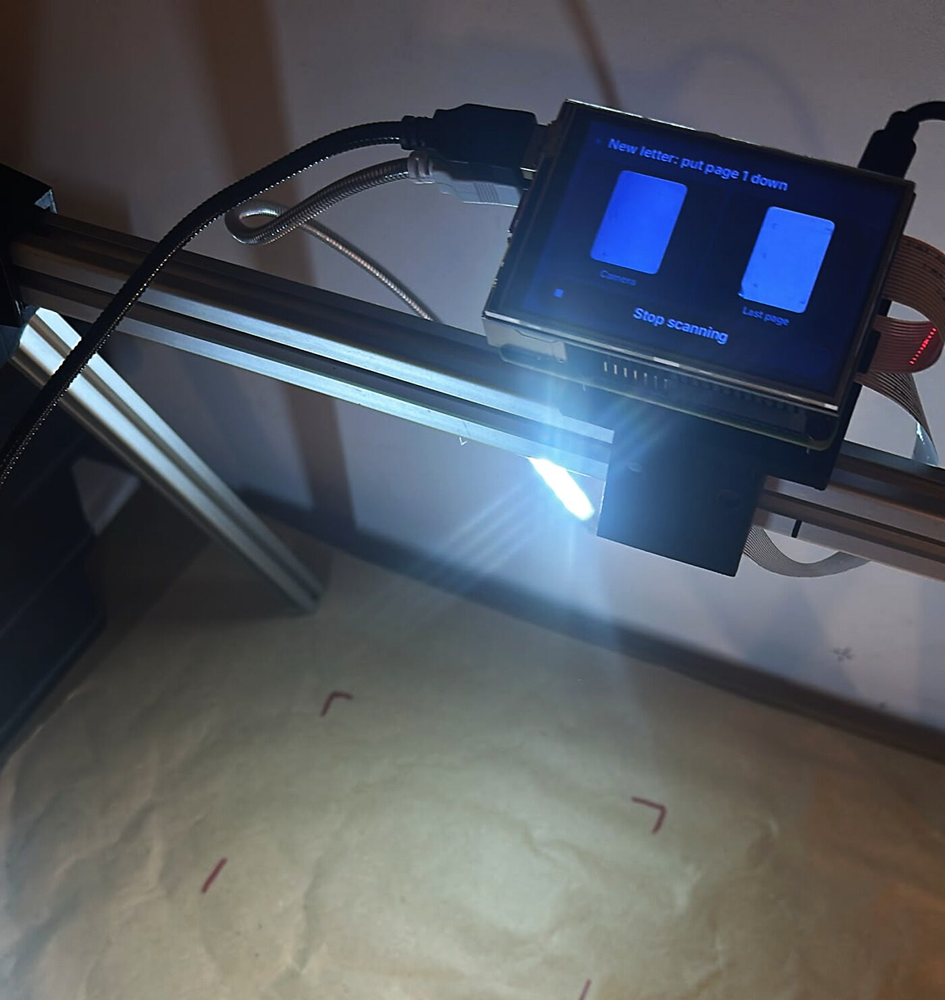

# The scanner: scannerd

`apps/scannerd` watches a surface through a camera. When a page is put down and
stops moving, it photographs it and hands it to Paperless-ngx.



That is all it does. Paperless already does OCR, deskewing, rotation, tagging,
archiving and search. scannerd only notices that a letter has arrived.

- No deskew. ocrmypdf does that inside Paperless.
- No page-finding. The camera is fixed above one spot, so the crop is one
  setting (`--roi x,y,w,h`).
- No image library. `rpicam-still --encoding yuv420` returns raw YUV, whose
  first plane is the greyscale image. Detection is arithmetic over bytes and
  can be tested on a laptop with no camera.

## How it decides

It compares frames with a baseline of the empty surface and checks three
things:

- Is something there? A sheet of paper changes a great many pixels.
- Does it look like paper? Measured in 16×16 blocks against the table's own
  level, it must be paler than the table by 35 counts and form one lump. An
  evening darkens everything and does not count.
- Has it stopped moving? A hand stays in shot for a moment after the page.

After a capture it does not arm again until it has seen the surface empty,
which relearns the baseline. The baseline is also relearnt when the light
changes over an empty table.

A capture is written to the spool directory before any upload is tried, and
removed only once Paperless has confirmed it. Waiting uploads are retried every
30 seconds (`--drain-every-secs`), backing off to at most five minutes. An
upload that has not finished in two minutes is kept for later, so it does not
hold up the camera.

## Letters of several pages

With `--button`, pages collect until the button is pressed, and the letter goes
to Paperless as one PDF with the photographs embedded unchanged. A letter
nobody closes is sent `--letter-idle-secs` (five minutes) after its last page.
Without `--button`, every page is its own document.

The button is a push button between GPIO 27 and ground (pins 13 and 14). One
line in `/boot/firmware/config.txt` makes the kernel treat it as a key:

```text
dtoverlay=gpio-key,gpio=27,active_low=1,gpio_pull=up,keycode=28,label=scannerd
```

GPIO 17 is the e-paper display's reset line, so the button no longer uses it.

After a reboot the button shows up under `/dev/input/by-path/`. Point
`SCANNERD_BUTTON` at it. A USB keypad works too (`--button-key` for a key other
than Enter), and on a laptop `--button stdin` makes Enter the button.

## The display

`--display epaper` (or `SCANNERD_DISPLAY=epaper`) drives a Waveshare 2.13″ e-paper HAT
(V3/V4, SSD1680) on the header. It shows *Ready*, *Hold still*, *Scanned — take the page
away*, and below that whether the photograph can be read: *Page 2: good to
read*, or white on black *Page 2: too bright*, *blurry*, *no text found* or *no
page / too dark*. The check runs on every photograph and also appears in the
setup page's activity list. A page that fails is still kept and sent.

Between letters the display says which folder on the shelf the last letter goes
in. Set folders with `SCANNERD_FOLDERS=Car,House,Taxes,-Throw away` (the `-`
marks the bin) or under **Folders on the shelf** on the setup page. Each folder
is a Paperless tag of the same name, which scannerd creates before the next
letter is sent. With words, the tag matches any letter containing one of them.
Without words, Paperless learns it from the documents tagged with it. scannerd
then waits for Paperless to read the letter and shows the folder whose tag it
got.

If no folders are set, scannerd takes the shelf from Paperless: the tags that
match letters by themselves, which is what kuverta's setup assistant writes.
`SCANNERD_BIN_FOLDER=Werbung` names which of them is the bin.

Two buttons on the display file a letter by hand when Paperless got it wrong.
**No folder** takes the folder tags off it, **Throw away** puts the bin's tag
on. Either way the letter stays in Paperless.

`SCANNERD_PEOPLE=Erika Mustermann,Max Mustermann` adds the people in the
household. Each is a tag of its own (`Person: …`) matched on the name, and the
display says who a letter is for as well as which folder it goes in.

The page has a **preview mode** (<kbd>p</kbd>) for working through a pile with
a keyboard. It shows the page large, what `tesseract` on the Pi read on it,
every folder as a chip with a number key that files the letter there, and a
field that adds a new folder from the current letter. Both screens use
kuverta's own colours.

`SCANNERD_DISPLAY=/dev/fb0` draws the same in colour on a 3.5″ SPI LCD
(`dtoverlay=piscreen`). `SCANNERD_TOUCH=/dev/spidev0.1` makes its touchscreen
start and stop scanning: **Start scanning** and **Learn empty table** between
letters, and while scanning the live camera view beside the last page, with
**Finish letter** and **Stop scanning**. The readme has the setup, including
keeping the kernel's touch driver off the controller.

The display needs `dtparam=spi=on` in `/boot/firmware/config.txt` and the `spi` and
`gpio` groups for the `scannerd` user. `SCANNERD_DISPLAY_FLIP=true` turns the
picture upside down.

## The setup page

`--ui 0.0.0.0:8080` (or `SCANNERD_UI`) serves a page from scannerd itself, so a
headless Pi needs no screen. Open `http://<pi>.local:8080` on a phone. It shows
what the camera sees and what scannerd makes of it (*Ready — put a page down*,
*Hold still…*, *Photographed — take the page away*), the pages of the current
letter with **Finish letter**, what was sent and what is waiting, and setup:

- **Take a picture** finds the page and proposes the crop. Adjust it and **Save
  this area**.
- **The camera looks at the table at an angle**: drag four corners onto a page,
  and every photograph is straightened (about five seconds a page on a Pi Zero W).
- **Turn left** / **Turn right**, for a camera mounted so letters are not upright.
- The Paperless address, token and tags, with **Check connection**, and **Learn
  empty table**.

Settings saved there go to `settings.toml` in the spool (owner-only, it holds the
token) and win over the env file. Any address other than loopback needs
`SCANNERD_UI_PASSWORD`, because the page shows photographs of your post.

## Hardware

Tested on a Raspberry Pi Zero W (Rev 1.1) with the OV5647 camera, running
32-bit Raspberry Pi OS bookworm, and a Waveshare 2.13″ e-paper HAT on the
header. A preview frame takes 1.1 to 1.7 seconds there, because `rpicam-still`
starts the camera each time, and a full capture takes about 3.7. A page is
photographed eight or nine seconds after it is put down. The
`3dprints/stand/` folder of the repository has OpenSCAD sources and STL files
for a stand built from 2020 aluminium profile, with a camera mount.

## Building for the Pi

Cross-compile from the workspace root with
[cargo-zigbuild](https://github.com/rust-cross/cargo-zigbuild) and zig:

```sh
rustup target add arm-unknown-linux-gnueabihf     # Pi Zero W: ARMv6, 32-bit
cargo install cargo-zigbuild                      # and zig from ziglang.org on PATH
make scannerd-pi                                  # target/arm-unknown-linux-gnueabihf/release/scannerd
make scannerd-to-pi PI_HOST=pi@raspberrypi.local  # copies it to ~/scannerd, installs nothing
```

A Pi Zero W runs neither 64-bit Raspberry Pi OS nor an aarch64 binary. A Zero 2
W, 3, 4 or 5 on the 64-bit OS needs `PI_TARGET=aarch64-unknown-linux-gnu.2.36`
(after `rustup target add aarch64-unknown-linux-gnu`). The `.2.36` pins glibc to
bookworm's.

## Installing on the Pi

scannerd runs as its own user with access to the camera and input devices only.
It holds a Paperless token, so it should not be able to read the `pi` user's
home:

```sh
sudo useradd --system --no-create-home --shell /usr/sbin/nologin --groups video,input scannerd
sudo install -m 0755 scannerd /usr/local/bin/
sudo install -m 0644 scannerd.service /etc/systemd/system/
sudo install -m 0600 scannerd.env.example /etc/scannerd.env   # then fill it in
sudo systemctl enable --now scannerd
journalctl -u scannerd -f
```

Tags are given by name and must exist in Paperless first. An unknown tag name
fails the upload with that name in the error, and the capture is kept.

## Without a Pi

`apps/scannerd/tools/rpicam-still-ffmpeg` stands in for `rpicam-still` using
ffmpeg, so the whole daemon runs on a laptop against the dev stack:

```sh
# a still image as the camera; point the symlink elsewhere to "put a page down"
ln -sf desk.jpg /tmp/camera.jpg
SCANNERD_FAKE_INPUT=/tmp/camera.jpg PAPERLESS_TOKEN=... \
  scannerd --camera apps/scannerd/tools/rpicam-still-ffmpeg --spool /tmp/spool --tag "Musterstraße 1"

# or the laptop's own camera
SCANNERD_FAKE_INPUT=0 PAPERLESS_TOKEN=... \
  scannerd --camera apps/scannerd/tools/rpicam-still-ffmpeg --spool /tmp/spool
```

`scannerd --drain-only` uploads whatever is spooled and exits. Use it for a
cron job, or to check the upload half before there is a camera.

```sh
cargo test -p scannerd    # detector, spool, uploader, letters, button, PDF — no camera needed
```
