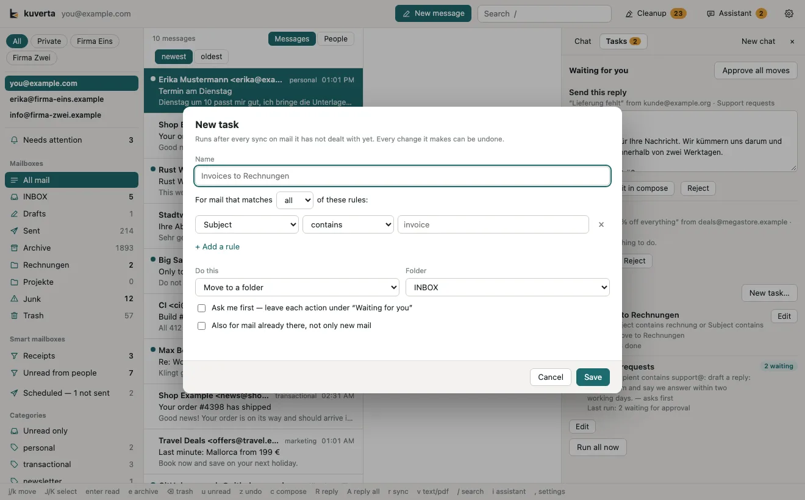

# Assistant and tasks

The **Assistant** button in the header (or <kbd>i</kbd>) opens a panel on the
right with two tabs: **Chat** for questions and instructions about your mail,
and **Tasks** for standing jobs.

## Chat

Ask in plain words: *"What needs my attention today?"*, *"Archive the
newsletters I haven't opened in a month"*, *"Draft a reply to Erika saying
Tuesday works"*. The chat works on the account on screen. **New chat** or
switching accounts starts a new one.

Everything the assistant does shows in the conversation:

- **Looking**: a search, a list, reading a message, the
  [Needs attention](attention.md) ranking or a [conversation](people.md) shows
  as a grey line (*"searched for invoice — 12 found"*).
- **Changing**: move, archive, trash, mark read, file under a category and
  create a folder show as a card with **Undo**. Changes are queued before they
  reach the server, and Undo takes them back while they wait.
- **Replying**: the assistant never sends mail. A drafted reply is a card you
  can edit, then **Send** (after a confirmation) or **Open in compose**.
- **Forwarding**: *"Forward the booking confirmations from the hotel to
  Clara"* makes one draft with a note, the text of every forwarded message and
  all their files. A draft can also carry one file from other mail (*"Reply to
  Clara with the invoice from the plumber"*). Click a file on the card to check
  it. Only you send the draft.
- **Tasks**: say *always*, *automatically* or *from now on* and it creates a
  task (below). It shows the rules in words and how many messages they match
  now, so you can catch a rule that is too wide or too narrow before it acts.
- **Documents**: a PDF it wrote or signed (below) is a card with **Show**,
  **Save to Downloads**, **Attach to a new message** and **Delete it**.

Before moving or trashing more than 30 messages it says how many and asks.

If an answer fails (the model's service is down, or a hosted one is out of
credit), the error shows with **Retry**, which asks the same question again
once you have fixed the cause.

### Earlier chats

Conversations are saved per account. **Earlier chats** in the panel's header
lists them, newest first, named after their first question. Open one to read
it with its cards and continue it. **×** deletes it. **New chat** starts a new
one.

### Memory

The assistant keeps short notes per account across conversations, such as who
your tax adviser is, which folder a kind of mail goes to, or how you sign
letters. They are sent with every question, which saves searches and tokens,
so they are limited to 60 notes of 300 characters each.

It keeps a note when you tell it something worth remembering or agree to it,
and never because a message asks (mail is written by strangers). Each new note
shows as a **Remembered** card with **Forget**. Saying "forget that" or "that
has changed" also works. **Settings → Assistant memory** lists every note to
correct, add or forget.

**Sync the notes through this account's mail server** keeps them the same on
every computer. They are stored as one message in a folder named *Kuverta
Memory*, which kuverta hides from your mail. It is signed with the account's
OpenPGP key and encrypted to that key only, so the server and anyone reading
your mailbox there see only that it exists. Messages in that folder not signed
by your key are ignored.

Another computer needs the same key. Import the secret key under
**Settings → Encryption**, from GnuPG, Thunderbird, or the file
`pgp/<fingerprint>.secret.asc` in kuverta's data folder (protected by the key's
passphrase). kuverta never shows a secret key, so there is no copy button.

Notes sync with the mail. If two computers changed something, both changes are
kept, and the later one wins for the same note. A replaced copy goes to the
Trash. Syncing needs your own key for the account with its passphrase stored.
Without one, the switch says what is missing.

### Working on a message you have open

**Ask the assistant** on an open message hands it over with your question.
<kbd>Shift</kbd>+<kbd>I</kbd> does the same for the message under the cursor,
or for several you have picked. The messages show above the chat box, each
with **×** to leave it out:

- *"Reply and confirm the appointment."*
- *"What does this need from me?"*
- *"Write a summary of this for clara@example.com so I can send it."*

The assistant gets the text of those messages with the question, so it need
not search first, which helps a small model. Up to five messages go along, and
about four pages of each.

A reply comes back as a card you can edit and **Send**, or **Open in compose**.
A message to somebody else comes back the same way, addressed to whoever you
named. The assistant sends neither.

### Finding a message

*"I got an eSIM by mail a while ago, how do I get to it?"*, *"Where is the
contract from the gym?"*, *"Find the train tickets for Hamburg."* The assistant
searches all your stored mail, however old, and tries other spellings, German
and English words, the parts of a compound word and the likely sender. It
shows the message as a **card** with subject, sender and date, a line on what
it found, **Open message**, and the message's
[attachments](reading.md#attachments), which open from the chat with a click.
The QR code of an eSIM, a ticket or a contract is usually there. The assistant
reads the message's text and can tell you what it says to do, but it does not
look inside attachments.

## Writing and signing PDFs

The assistant writes PDF documents: *"Write a letter cancelling my gym
membership as a PDF"*, *"Put the invoice numbers from this month in a PDF"*.
The text is set in a plain typeface on A4, with a title, headings, lists and an
address block kept line by line. The document shows as a card to open in the
viewer, save, or attach to a new message. *"Send it to the gym"* drafts a
message with the document attached, which only you send.

It can also **sign** a PDF it wrote or one that came as an attachment, such as
a contract to return. *"Sign the lease in the mail from the landlord and reply
with it"* signs a copy (the original is never changed), shows it as a card, and
drafts the reply with the signed copy attached.

It looks for the signature line on the page (the rule with *Unterschrift* or a
name under it) and puts the signature there, with the place and date beneath
if there is room. If a contract has a line for each party, it lists the lines
and asks which is yours. With no line at all, it uses the bottom of the last
page. If the spot is wrong, say so (*"on page 2, bottom right, a bit higher"*)
and it signs the original again there.

You can also place it yourself. **Move the signature…** on the document's card
shows the page as a picture with your signature on top. Drag it onto the line,
set its width, turn the page if it belongs on another one, and press
**Put it here**. This signs the original again at that place and keeps the
same name, so a copy already attached to a message you are writing still
points at it. Nothing is sent.

Signing needs a picture of your signature, set under
[Settings → General → Signature](settings.md#signature). Without one the
assistant writes PDFs but says it cannot sign. The signature is a picture, as
on a page you printed, signed and scanned. It is no certificate. The assistant
places it only when you ask and never sends what it signed.

Ask *"which documents have you made?"* for the list. The assistant can read,
rename and delete them. They are kept per account, with your mail.

## Tasks

A task is a standing job for mail as it arrives. It says which mail (the same
rules as a [smart mailbox](smart-mailboxes.md)) and what to do with each
message.

| Action | Needs a model | |
| --- | --- | --- |
| Move to a folder, Archive, Move to Trash, Mark read, File under a category | no | Done to every matching new message. |
| **Draft a reply** | yes | The model writes a reply from your instruction ("thank them, say we answer within two working days, ask for the order number"). Always waits for you. |
| **Let the model decide** | yes | The model reads each message and picks one of the actions above, a reply, or nothing, by your instruction. |

Tasks run after every sync, once per message, on mail they have not handled
yet. **Run all now** runs them straight away. A new task handles only mail that
arrives from then on, unless you tick **Also for mail already there**.

**Ask me first** makes a task put each action under **Waiting for you** instead
of doing it. **Approve** (or **Approve all moves**) does it, **Reject** drops
it. A drafted reply always waits there: **Send** it, **Edit in compose** first,
or **Reject** it. The Assistant button shows how many are waiting.

Make a task by asking the assistant, or with **New task…**. The editor shows
how many messages the rules match as you write them. Switch a task off with
its checkbox, or change or delete it with **Edit**.

## Which model

The assistant needs a model that can call tools, and larger models do better.
It uses the sorting model until you give it its own in
**Settings → Models → The assistant**. **Try them** checks that the chosen
model calls tools. Small local models (3B) can answer questions but often fail
at tasks, and at the repeated searches with different words that finding an
old message takes. A 7 to 14B local model, or a hosted one, does much better.
Without any model, the [search box](reading.md#searching) still finds *esim*
in *e-SIM*.

With a hosted model, whatever the assistant searches for and opens is sent to
that service. The line under the chat says which model is answering and where.
Tasks that ask a model send the message they are about.

Some hosted services filter what they are sent and refuse a request that
trips the filter, as spam and phishing mail do. DeepSeek answers *Content
Exists Risk*. The assistant then asks once more without the mail from that
question and tells you some mail could not be read. If the service refuses
again, it says so. A model on this computer has no such filter.
