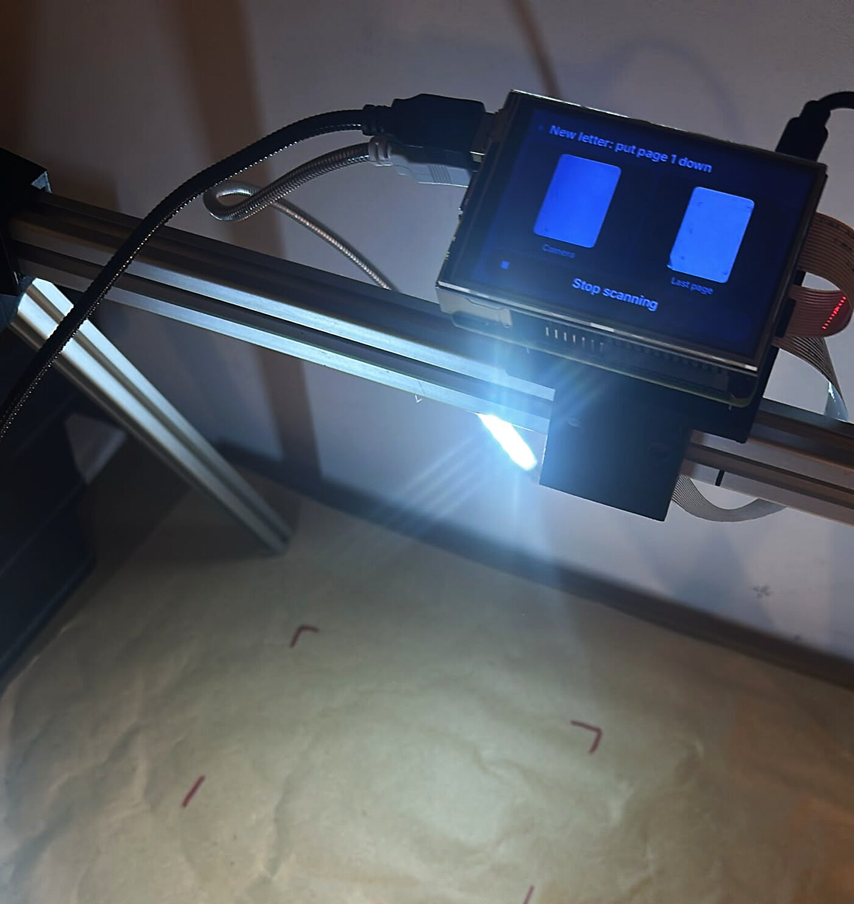

# Paper post

In kuverta a postal address is an account, and
[Paperless-ngx](https://docs.paperless-ngx.com/) is its server. Paperless does
the scanning intake, OCR, archive and search. kuverta shows what it holds like
mail: the correspondent is the sender, the title the subject, the scanned text
the body, and the date on the letter the arrival date. The same classifier
sorts it.

kuverta only reads from Paperless. It never changes, moves or deletes a
document there.

## Setting up a postal address

The [setup assistant](../install.md#the-first-run) can connect to your
Paperless or install one with Docker. To add one by hand, open **Settings** and
press **+ Add** beside *Postal addresses*:

- **Description**: the name in the sidebar, such as *Home*.
- **Paperless-ngx address**: for example `http://paperless.local:8000`.
- **Which post belongs here**: *all of them*, or only documents *with the tag*,
  *from the correspondent*, or *in the storage path* you name. To serve several
  addresses from one Paperless, give each its own tag.
- **API token**: from Paperless, under your name → *My Profile*. It is kept in
  the system keychain.

Press **Verify** before **Save**. It says how many documents the address
matches. If there are none, it names the tags that exist, so you can spot a
mistyped tag.

## Reading post

Each postal address appears under **Post** in the sidebar with its unread
count. Click it to see its letters, newest first.

- The line above the list sorts by **letter date** (the date on the letter) or
  **scanned** (when it came through the letterbox).
- Opening a letter marks it read, and <kbd>u</kbd> toggles it. kuverta keeps
  this state itself, since Paperless has none.
- **Text** and **PDF** above the letter, or <kbd>v</kbd>, switch between the
  text and the scan. The choice is kept from letter to letter.
- Search (<kbd>/</kbd>) uses Paperless's full-text search over the scanned text.
- The sidebar categories count and filter post as they do mail.
- Paperless does not announce new letters, so kuverta checks the open postal
  address about every twenty seconds and new letters appear on their own.
  <kbd>r</kbd> checks at once.

You cannot reply to, archive or delete post from kuverta, because it belongs to
Paperless. Those keys only tell you so.

## Reading scans with the vision model

Paperless's OCR is sometimes unreadable, especially for photographed letters.
kuverta can have a vision model (a model that can look at images) read the scan
instead.

Unopened new letters are read this way as they arrive, one at a time, so the
list can show the sender and subject and sort the letter from readable text. A
note above the text says whose reading it is:

- *This is Paperless's OCR.* has **Read with the vision model** beside it.
- *Read from the scan by …* is the model's reading, with **Read again**. The
  model can get a word wrong where the scan is unclear. The PDF tab has the
  page itself.

You choose the model and where it runs in [Settings → Models](models.md). The
default is a small model run by Ollama on your computer, so the scans do not
leave it. If the model fails (Ollama is not running, say), kuverta stops trying
for new post and says why above the text.

## Filing post

In [Cleanup](cleanup.md), file letters with <kbd>1</kbd> to <kbd>6</kbd> like
mail. Filing pins a letter to that category, whatever the rules say. When
Paperless knows the correspondent, kuverta learns it too and files the next
letter from that sender the same way without asking.

## Capturing post: the scanner

Paperless takes documents from any scanner. The project also has its own:
[`scannerd`](../developers/scanner.md), a small program for a Raspberry Pi with
a camera fixed above a spot on a table. It notices a page being put down,
photographs it once it is still, and hands it to Paperless, tagged for your
postal address. A capture stays on the Pi until Paperless confirms it, so a
dropped network or a flat battery causes a retry and no lost letter.

It has a setup page for your phone, and optionally a button to press when a
letter of several pages is complete. [Developers](../developers/scanner.md)
describes how to build and install it.

The current rig is a Pi with a camera and a touchscreen on a length of
aluminium profile, a lamp, and a sheet of kraft paper with corner marks for the
page. The screen says what to do next ("New letter: put page 1 down") and has a
button for the last page of a letter. The 3D-printed frame and camera mount are
in the repository under `3dprints/`.
