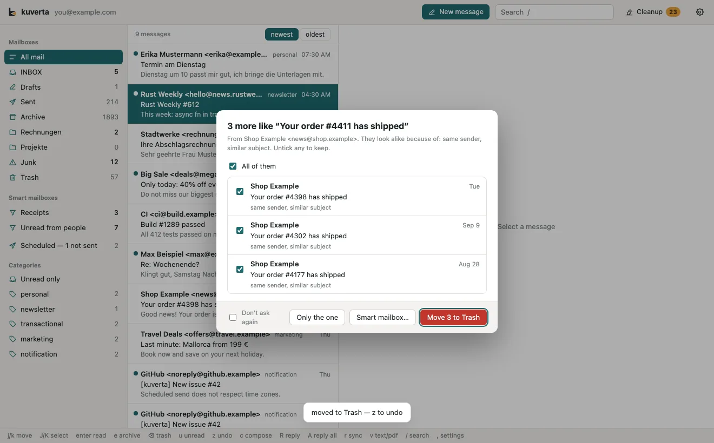

# Similar messages

Spam and bulk mail come in runs: the same shop with a new order number in the
subject, the same newsletter every week, or the same text from a different
sender each time. When you delete a single message, kuverta looks for others
like it and, if it finds any, asks what to do with them.

The dialog says how many it found and why they look alike. Each message is
listed with sender, date, subject and its own reason. Every one is ticked, so
you see everything that would go. Untick the ones to keep.

- **Move N to Trash** moves the ticked ones. Each is its own queued change, so
  <kbd>z</kbd> brings them back one at a time while they wait to reach the server.
- **Smart mailbox…** opens the [smart mailbox editor](smart-mailboxes.md) with
  rules that would gather these and the next one like them, to deal with later.
- **Only the one** leaves them where they are.

## What counts as similar

kuverta compares the deleted message with the recent mail of the same account
that is still somewhere you receive mail (so outside the Trash, Sent and
Drafts) and gives the first reason that fits:

| Reason shown | Means |
| --- | --- |
| same mailing list | The same `List-Id`. |
| same sender, similar subject | The same address, with a subject built the same way ("Your order #1234 has shipped", "Your order #5678 has shipped") or nearly the same text. |
| same subject and text | Different senders, but the same subject line *and* much the same text. |
| nearly the same text | Near-identical text from different senders: what a spam run looks like. |

Some mail is never offered, whatever it looks like:

- Conversations: mail filed as *personal*, and replies (anything answering
  another message, or with a subject starting *Re:* or *AW:*). Many people write
  "Rückfrage zum Angebot", and deleting one such message says nothing about the
  others.
- Mail that only shares a provider. Two senders at gmail.com, web.de or gmx.de
  have nothing else in common, so a shared domain never counts on its own, and
  a suggested smart mailbox never names such a domain.

## Turning it off

Tick **Don't ask again** in the dialog. To have it back, tick **After deleting a
message, offer to delete messages like it too** in **Settings → General**.
