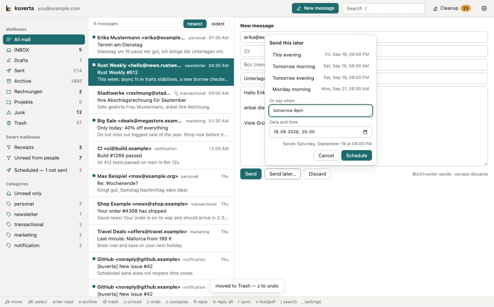
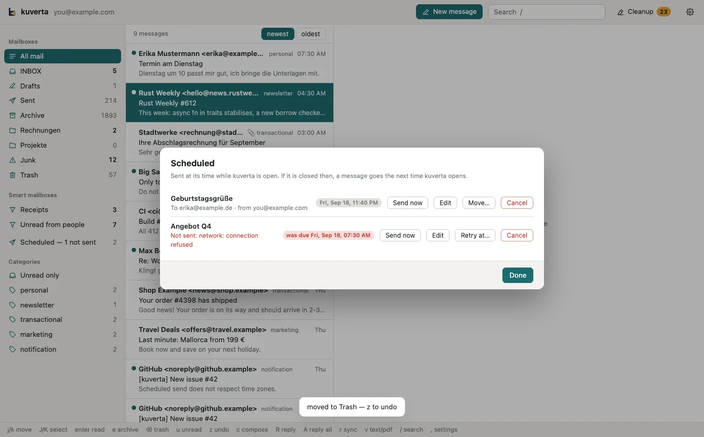

# Writing

## New message, reply, reply all, forward

| | Key | Button |
| --- | --- | --- |
| New message | <kbd>c</kbd> | **New message** in the header |
| Reply to the sender | <kbd>R</kbd> | **Reply** above the open message |
| Reply to everyone | <kbd>A</kbd> | **Reply all** |
| Forward | <kbd>f</kbd> | **Forward** |

The keys are case-sensitive: <kbd>R</kbd> and <kbd>A</kbd> are capitals
(<kbd>r</kbd> is sync). They act on the message under the cursor in the list.
Each one also has a button.

Compose opens under the message, so a reply or a forward keeps the original on
screen above it. For a reply, kuverta fills in the recipients and the subject,
and **reply all** leaves you out of the recipients and honours the original's
`Reply-To`. A forward starts with an empty **To**.

After sending, the message you answered shows a **↩** in the list and says
*answered* when you open it. This is the `\Answered` flag every mail program
writes, so a reply sent from your phone shows here too, and the other way
round.

### The fields

- **To**, **Cc** and **Bcc** take addresses separated by commas.
- **Bcc** never appears in the message itself. Blind recipients are only in the
  envelope the server delivers to.
- The line beside the title shows who will receive it, Bcc included, and
  updates as you change the recipients. Check it before sending: it is the only
  place a blind recipient is shown.
- **Sign** and **Encrypt** appear when you have OpenPGP keys. See
  [Encryption](encryption.md).

### Sending

**Send**, or <kbd>⌘</kbd>/<kbd>Ctrl</kbd>+<kbd>Enter</kbd>. The message goes to
the account's outgoing (SMTP) server, and a copy is filed in the account's Sent
mailbox. If sending worked but filing the copy did not, kuverta says exactly
that, so you do not send the message twice.

**Discard**, or <kbd>Esc</kbd>, closes compose and throws the message away.
Discarded messages are not kept as drafts.

Sending needs an outgoing server, set under **Outgoing mail** in the account's
settings.

### Files going with it

**📎 Attach**, or drop files anywhere on compose. Each file is a chip under the
body. Click it to view it (in the same safe preview as a file that arrived)
and press its **×** to remove it. A message can carry 25 MB of files, which is
what most servers accept.

!!! note "Not yet"
    There is no rich text: mail is written as plain text.

## Letting the assistant write it

**✨ Answer with assistant** in compose hands the assistant the message being
answered, the files already attached, and whatever you have typed, which it
takes as the brief. <kbd>a</kbd> on an open message opens the reply and writes
it in one step. A note like *"zusagen, aber erst ab Mittwoch"* is followed, and
a half-written reply is finished in your own words. The result replaces the
body, and <kbd>⌘</kbd>/<kbd>Ctrl</kbd>+<kbd>Z</kbd> brings your notes back.

If a message asks for something back signed (a contract, a form), the
assistant puts [your signature](settings.md#signature) on the attachment, on
the document's signature line, and adds the signed copy to the outgoing files
as a chip. Click it to check where the signature landed, or press its **×** to
remove it. The original is never changed, and nothing is sent until you send
it yourself.

## Send later

**Send later…** beside Send asks when.

- **Presets**: *This evening* (18:00, offered before four in the afternoon;
  later in the day it is *In an hour*), *Tomorrow morning* (8:00), *Tomorrow
  evening* (20:00) and *Monday morning* (8:00). One click schedules it.
- **Or say when**: type it as you would say it, in English or German:

    | You type | Means |
    | --- | --- |
    | `tomorrow 8pm` | tomorrow at 20:00 |
    | `monday 9:00` | next Monday at 9:00 (on a Monday, the one after) |
    | `in 2 hours`, `in 30 min`, `in 3 days` | from now |
    | `morgen 20 Uhr` | tomorrow at 20:00 |
    | `Montag morgen` | Monday at 8:00 |
    | `24.12. 18:00`, `2026-12-24 18:00`, `24 dec 6pm` | that date and time |
    | `tonight` | today at 20:00 |
    | `evening 8`, `8 abends` | 20:00 today, or tomorrow if that has passed |
    | `tomorrow` | tomorrow at 8:00, the start of a working day |

- **Date and time**: a calendar and clock.

The time is read back in full, for example "Sends Saturday, September 19 at
20:00", before **Schedule** is possible. A time that has already passed, or
text kuverta is not sure about, is not accepted, and it asks again.

The message is checked when you schedule it. It is built exactly as sending
would build it, so a mistyped address is refused right away and does not fail
at send time.

!!! warning "kuverta sends it, so kuverta has to be running"
    Scheduled mail is sent by kuverta itself, because no mail server holds it
    in a way every client can use. If kuverta is closed at the time, the
    message goes the next time you open it, and the list of scheduled mail says
    when it was due.

## Scheduled mail

While something is waiting, **Scheduled** appears in the sidebar with a count.
Click it for the list.

For each message:

- **Send now** sends it straight away.
- **Edit** takes it out of the schedule and back into compose, from the account
  it was going to be sent from. Send it, or schedule it again.
- **Move…** picks a new time.
- **Cancel** removes it; it will not be sent.

A message that could not be sent shows **Not sent** with the reason, and the
sidebar says *Scheduled — 1 not sent*. **Retry at…** gives it a new time, and
**Send now** tries again at once.

A send that was interrupted (kuverta closed or crashed while handing the
message to the server) is never retried automatically. It may or may not have
gone out, so it is marked as not sent with a note to check your Sent mailbox
before sending it again. A message sent twice cannot be taken back.
